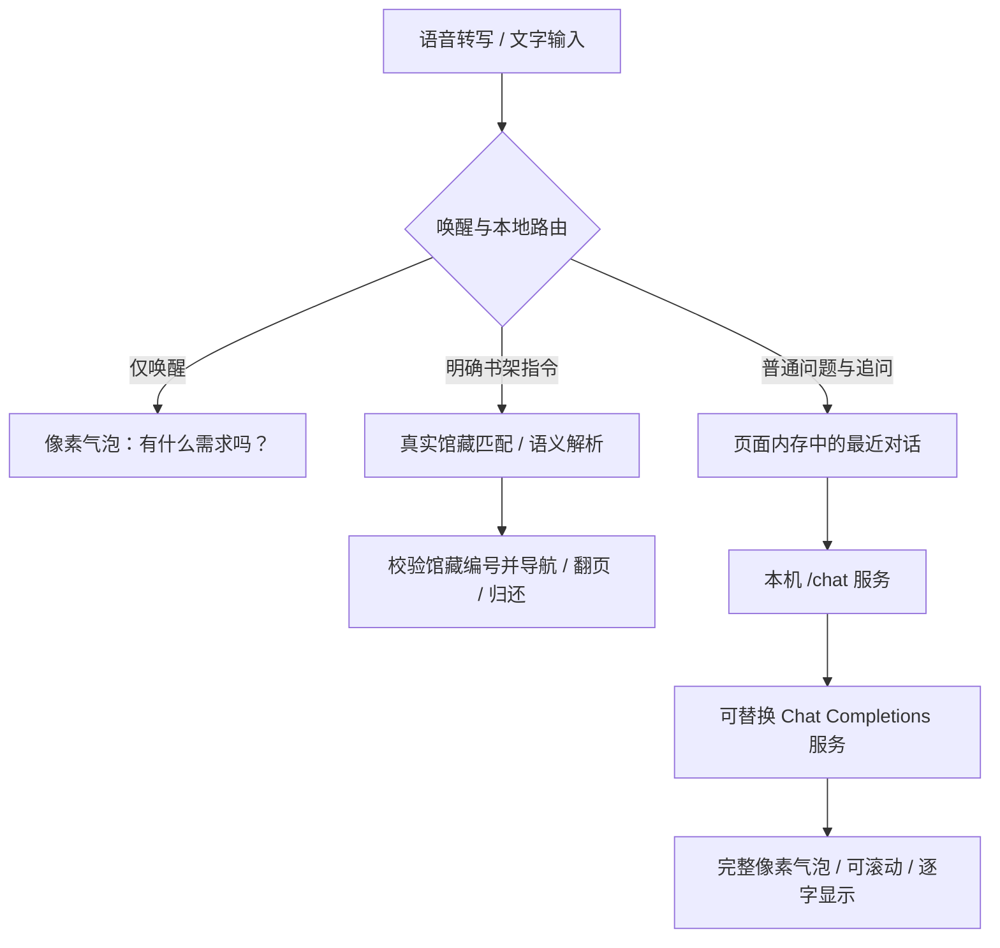

# 小和的大模型大脑

小和支持通过远程 API 自由问答和多轮追问。本机仅运行界面、语音识别与书库，不需要在本机部署大语言模型或配置高性能显卡。

## 开始使用

1. 打开图书馆，点击右侧「和 · 对话」中的「模型设置」，设置会在程序内部打开，不跳转到外部浏览器；关闭设置后保留原来的书籍、阅读进度与对话。也可以独立访问本机服务的 `/settings`。
2. 选择 DeepSeek 预设，填写自己的 API 密钥。默认地址为 `https://api.deepseek.com`，模型为 `deepseek-flash`。
3. 点击「保存并测试连接」。这会向配置的服务发送一次真实、简短的 API 请求；成功后下一次提问就会使用该配置。
4. 启动语音感知，说「小和，什么是机器学习？」。只说「小和」时仍只回应「有什么需求吗？」，不移动。也可以打开右下角「和 · 对话」使用唯一的文字输入入口；底部仅保留语音开关与识别状态。
5. 在唤醒窗口内接着问「能举一个例子吗？」。超过窗口后再说一次「小和」；文字输入始终不需要唤醒词。

所有模型回答都在像素气泡中完整逐字显示，不做摘要截断，也不会因语音提问自动弹出面板。长回答可在气泡内滚动，点击「显示全文」立即完成文字显示，点击「收起」关闭；回答会保留到主动收起或下一次交互，不随唤醒窗口结束消失。小和有本机长期记忆：说「记住……」会记下这件事，打开过的书与每段对话的一句话摘要也会被记录，聊天时最相关的几条（不超过 400 字）随问题发给模型；可在本机设置「小和记得的事」中查看、删除或关闭。读者明确要求时，模型可以调用界面工具替读者操作：切换天空、播放或暂停阅读音乐、翻到某一章、从书架取一本已入库的书；工具按当前状态提供，参数在服务端和页面各校验一次。回答经 `POST /chat/stream` 流式返回，气泡边收边打字；开启 ♪ 后每凑满一句就开始朗读，不等整段写完，等待提示「正在回应…」只显示不朗读。正文阅读期间气泡仍可见，宠物不在视野内时气泡固定在屏幕边缘。对话面板仅在手动点击「和 · 对话」后打开，供查看记录或文字输入。回答当前阅读书籍的问题时，会提供已验证的书名与作者；问到正在读的书、或问题里提到某本已入库的书时，会从本机全文索引检索**最相关的几段原文**（最多 4 段、共 1600 字）一并发给模型，让它按原文回答并标出章节，片段里没有的情节不编造，读者读到过的最远一章之后的段落不会被检索出来、也就不会发给模型，除非读者说“不怕剧透”“结局是什么”。**整本正文从不上传**；不问书里内容时不发送任何正文。

## 随时切换模型

填写服务商提供的 HTTPS API 根地址、模型 ID 与对应密钥，保存后下一次提问生效，不必修改源码或重新打包。程序自动追加 `/chat/completions`，不要把这个后缀重复填入接入地址。例如兼容服务要求 `/v1` 时应保留这个路径。

使用标准 Chat Completions 请求与 `choices[0].message.content` 响应。DeepSeek 的普通问答、找书解析及连接测试默认都使用 `thinking: {"type": "disabled"}` 关闭思考模式，不显示推理过程；此专用参数只会发送到 `api.deepseek.com`。普通问答不强制 JSON 输出；书籍语义解析需要服务支持 JSON mode。Anthropic、Gemini 等原生 API 协议需要兼容网关，不能只改地址就直接使用。某些模型不支持标准参数，需选兼容模型或接入转换网关。

部署也可以设置 `HEXU_LLM_API_KEY`、`HEXU_LLM_BASE_URL`、`HEXU_LLM_MODEL`。环境变量优先于本机设置；界面会说明密钥是否来自环境变量。`HEXU_LLM_CHAT_TIMEOUT` 控制服务端普通问答等待时间（默认 60 秒），前端默认最多等待 90 秒。找书语义解析仍使用 `HEXU_LLM_TIMEOUT`（默认 12 秒）。

## 上下文与取消

- 模型上下文最多最近 6 个成功轮次、24000 个字符，按完整问答对裁剪。上下文与面板记录仅保存在当前页面内存中；刷新、关闭页面或点击「新对话」即清空。面板最多展示 40 条记录，早于上下文窗口的消息不会再发给模型。
- 接入地址或模型名称改变后，下一轮会自动清除旧上下文。服务端也检查配置标识，处理设置刚好在请求期间改变的情况。
- 同一会话不并行提交多个问题。点击「停止等待」会中止前端等待，迟到的回答不会覆盖新对话；**已经发出的供应商请求可能仍会执行并计费**。
- 网络错误、密钥无效、接口不兼容或限流会明确显示，不伪装成回答，也不会把错误轮次加入上下文。

## 问答与书架动作

普通问题不会触发在线书源搜索、下载或书架移动。即使提到了已入库书名，「总结《三体》」「写一篇三体读后感」「推荐一本科幻小说」也按讨论或创作处理，而不是直接取书。明确的找书请求才走真实馆藏与在线正文书库流程；模型返回的书籍编号仍须存在于已入库书籍。翻页、开合、看芯片、归还等常见指令由本地规则即时执行，即使模型未配置也可以使用。问题中提到「下一页」「芯片」不会仅因出现关键词就执行动作。

自由问答支持可选的 DeepSeek 网页搜索与抓取工具，模型按需调用并引用来源，详见[联网工具说明](WEB_TOOLS.md)。未配置、关闭联网、查询失败或没有资料时必须说明，仍不能保证回答所有问题。它不能自行执行任意本机代码、读取本地文件或下载书籍入库。

## 模块与数据边界

| 模块 | 职责 |
| --- | --- |
| `src/app/dialogue.js` | 唤醒、普通问答与书架指令区分 |
| `src/app/assistant.js` | 同一 ASR/文字入口，取消过期任务并呈现结果 |
| `src/voice/chat.js` | 有界多轮上下文、配置变更、超时与取消 |
| `src/app/conversation.js` | 可滚动完整回答、停止等待、新对话与设置入口 |
| `tools/llm_chat.py` | 服务商兼容适配、历史校验、响应长度和错误处理 |
| `tools/web_tools.py` | 有界 Search / Fetch、官方搜索密钥隔离、网页来源校验 |
| `src/app/web-sources.js` | 气泡和对话面板共用的安全来源链接 |
| `tools/asr-server.py` | 本机权限、共享限流、配置解析、真实书籍上下文 |
| `tools/library-service.py` | 开发服务复用桌面版后端，无需初始化识别模型 |

浏览器只请求本机服务，密钥不进入前端、URL、仓库或对话存储。本机设置由使用者保存到用户目录；请求时后端解析配置，仅在向模型服务认证时使用。普通问答发送问题、最近成功对话及正在阅读的书名/作者；语义找书发送真实馆藏元数据。服务器不记录对话正文或供应商错误正文。第三方服务的数据保留规则以该服务为准。

`POST /chat` 与找书语义接口共享每地址每分钟调用额度；`/chat` 拒绝跨站网页与 DNS 重绑定主机名。单问题最多 4000 字符，回复最多 16000 字符，达到长度上限时面板提示可继续追问。展示回答采用纯文本而非 HTML，不执行模型返回的脚本或标签。

## 验证

`npm test` 覆盖上下文裁剪、模型切换、取消迟到结果、超时、错误、接口参数与本机访问边界。`npm run test:ui` 覆盖真实 Chrome 的问答呈现、多轮追问、切换模型、安全文本显示及完整书架阅读链路。回归测试使用模拟模型响应，不读取用户密钥、不调用付费 API；最终供应商连通性需要使用者在「保存并测试连接」中验证。

参考：[DeepSeek 多轮对话](https://api-docs.deepseek.com/guides/multi_round_chat/)、[Chat Completions 接口](https://api-docs.deepseek.com/api/create-chat-completion/)。
