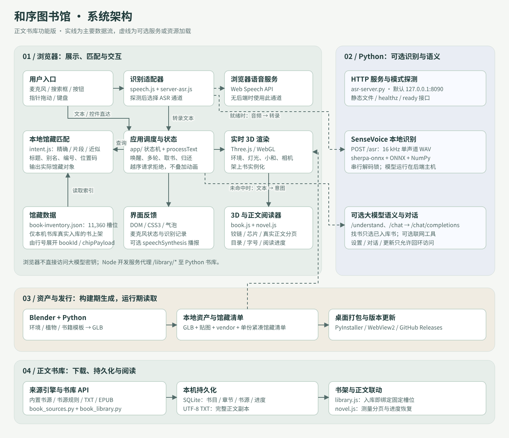
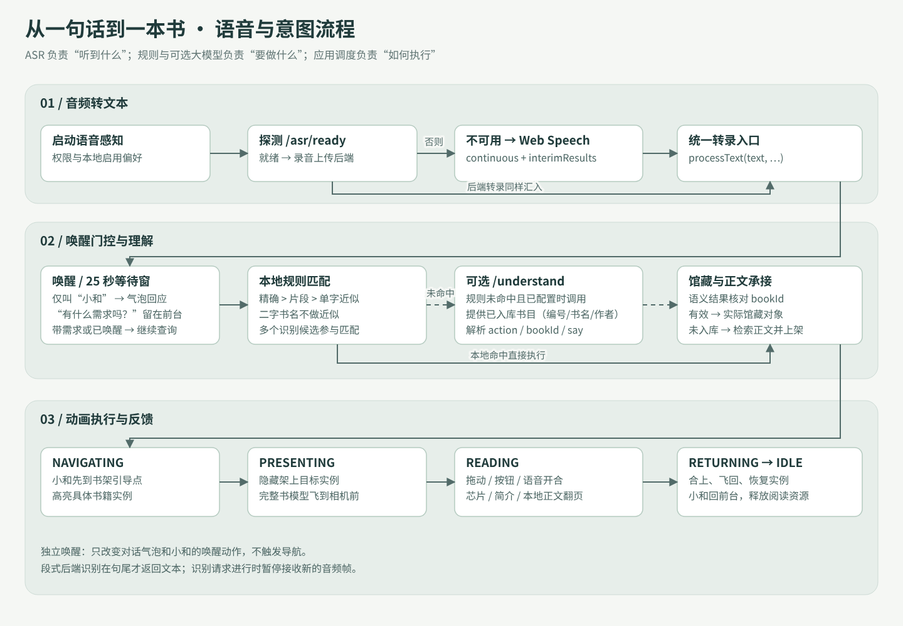
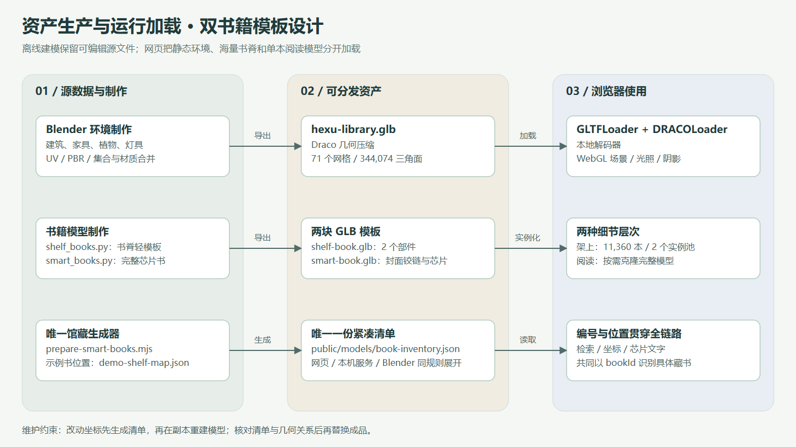

# 和序 · 虚拟智能图书馆：技术实现与系统架构

> 文档日期：2026-10-21。源码基线：`2.6.0`（`master`，含灯光、窗口、上架顺序、日月调度与本机语音播报更新）。本文根据当前源码、馆藏清单和导出清单整理，适合项目介绍、技术交接与演示准备。标为“建议”的内容尚未实现；数量与资源大小是该基线的数据，不代表未来版本。

## 1. 项目解决什么问题

和序图书馆把“说出需求、定位书籍、取书、阅读、归还”组织成一个可视化闭环。读者可以呼叫“小和”，也可以在对话面板输入书名、编号或位置码。系统匹配到已入库的书后，Blender 制作的像素宠物“小和”飞到书架引导，目标书飞到眼前；读者拖动封面翻开，可以进入正文逐页阅读，还可以放大查看嵌入式芯片。

书架提供 11,360 个物理槽位，但**不预置任何书目**：只有通过在线书源下载、或导入 TXT / EPUB 的真实正文才会上架，并绑定一个固定的 HX 编号与位置。配置大模型后，小和还能自由问答、多轮追问，并可按需联网搜索与读取网页。芯片是三维几何与数字标记，尚未对接真实 RFID、借还设备或图书馆业务数据库。

### 当前版本概况

| 项目 | 当前实现 |
| --- | --- |
| 书架 | 5 架，双面 A/B，各 4 层；每面分成 4 个开间 |
| 书架标称尺寸 | 长 8 m × 宽 1 m × 高 2 m；网页中沿 Z 轴延伸 |
| 槽位数量 | 11,360 个，即 5 × 2 × 4 × 284；各开间约 70 个位置，按可用长度计算 |
| 已上架书籍 | 0 本起步，只显示本机书库中真实入库的书 |
| 统一书籍尺寸 | 216 × 306 × 26 mm；书脊朝外竖排 |
| 编号范围 | `HX-00001`～`HX-11360`；芯片编号与书籍编号相同，仅已入库书籍可检索 |
| 环境 GLB | 71 个网格、344,074 个三角面、6,419,832 字节，约 6.12 MiB |
| 架上藏书 | 2 个 `InstancedMesh` 实例池；书脊轻模板共 216 个三角面 |
| 小和 | Blender 像素宠物：9 个网格、16 个节点、396 个三角面，GLB 约 35.2 KiB |
| 灯光 | 窗侧日光、8 盏吊灯、2 盏阅读灯，实时软阴影 + 2048×2048 烘焙接触遮蔽 |
| 日月 | 窗外像素太阳 / 月亮可切换：4 个网格、1,436 个三角面，GLB 约 52 KiB |
| 植物 | 6 盆盆栽、26 丛灌木，含 54 片曲面大叶和 14,144 片小叶 |

数量来源为 [馆藏清单](https://github.com/Amyias/hexu-virtual-library/blob/master/public/models/book-inventory.json)、[导出统计](https://github.com/Amyias/hexu-virtual-library/blob/master/public/models/manifest.json)、[小和模型清单](https://github.com/Amyias/hexu-virtual-library/blob/master/blender/xiaohe-pet-manifest.json) 和回归测试。早期版本的“12 本具名演示书 + 编号样书”已在 2.5.x 中移除；清空后的审计记录见 `blender/empty-shelves-audit.json`。

## 2. 系统架构



[单独打开架构 SVG](diagrams/architecture.svg)。图中文字与连线均为矢量元素，可在支持 SVG 的工具中编辑，缩放时不损失清晰度。SVG 内嵌全部图形与样式，可单独复制到其他目录离线打开，不依赖外部图片、脚本或字体下载。布局源文件为 [system-architecture.mjs](https://github.com/Amyias/hexu-virtual-library/blob/master/docs/system-architecture.mjs)，由 [generate-diagrams.mjs](https://github.com/Amyias/hexu-virtual-library/blob/master/docs/generate-diagrams.mjs) 统一生成。

若 Markdown 阅读器不显示 SVG，可打开 [架构图 PNG 预览](diagrams/architecture.png)。

架构图按六个边界组织：桌面窗口与浏览器共用网页入口；前端负责输入、意图分流、状态机、3D 阅读与像素气泡；Python 服务承接识别、播报、模型代理、书库及桌面维护；本机数据保存真实正文、进度、模型和私有配置；外部服务提供可配置的模型 API、书源及发行附件；Blender 与构建脚本负责离线资产和程序发行。静态站点可以独立展示场景，正文书库依赖 Python，模型能力通过就绪接口自动探测。自由问答的结果回到气泡，并优先由本机 PrimeTTS「欣然」播报，缺少播报模型时退回系统语音。

### 主要模块及边界

| 文件 / 模块 | 职责 | 主要边界 |
| --- | --- | --- |
| `src/main.js` | 启动应用、安装本机标题栏、显示加载异常 | 依赖或模型失败时给出可见提示 |
| `src/app.js` | 只做装配：创建场景、书库、语音与各控制器并连线 | 不包含业务规则，逻辑都在 `src/app/` |
| `src/app/phases.js` | 显式状态机 `IDLE → NAVIGATING → PRESENTING → READING → RETURNING` | 越序请求被拒绝而不是叠加动画 |
| `src/app/dialogue.js` | `decide()`：判断一句话是唤醒、找书、阅读指令、聊天还是交给模型 | 纯函数，不接触场景、DOM 与网络，便于单测 |
| `src/app/assistant.js` | `processText()`：执行 `decide()` 的结论 | 语音、对话面板与调试接口共用这一个入口 |
| `src/app/journey.js` | 取书与归还两段动画编排 | 每一步等待上一段动画，状态始终可知 |
| `src/app/reader-view.js` | 手中的书：铰链翻页、芯片特写、释放资源 | 阅读结束释放动态纹理 |
| `src/app/feedback.js`、`pixel-dialogue.js`、`project-dialogue.js` | 像素气泡、逐字打字、气泡跟随小和投影 | 气泡为 DOM 叠加层，按相机同步后的姿态定位 |
| `src/app/conversation.js`、`src/voice/chat.js` | 对话面板与有界多轮上下文 | 上下文只在页面内存，不写本地存储 |
| `src/voice/speech.js` | 识别器生命周期、候选、重连、记录 | 将转录结果同步送到 `processText` |
| `src/voice/server-asr.js` | 浏览器录音、断句、WAV 上传 | 启用前先探测 `/asr/ready` |
| `src/voice/voice.js`、`tools/tts.py` | 分句请求本机 PrimeTTS，并播放 WAV | `/tts/ready` 不可用时退回系统语音；可取消当前播报 |
| `src/voice/intent.js` | 标题、别名、编号与位置匹配 | 只索引已入库书籍，空槽位不参与 |
| `src/voice/understand.js` | 语义请求与超时降级 | 放在应用调度层，不阻塞识别器同步派发 |
| `src/scene/runtime.js` | 渲染器、相机、色调映射 | 统一米制坐标和渲染设置 |
| `src/scene/lighting.js` | 窗侧日光、吊灯、阅读灯、接触遮蔽，昼夜配色 | 灯位来自 `public/models/lighting-rig.json`；昼夜只改颜色与强度，不移动光源 |
| `src/scene/sky.js` | 窗外像素太阳与月亮、日月切换 | 方位与日光一致；不投射阴影，不受雾与色调映射影响 |
| `src/scene/sky-schedule.js` | 按本地时间在 08:00 与 17:00 切换昼夜 | 手动切换只保持到下一个日夜边界 |
| `src/scene/environment.js` | 环境与两种书籍模板加载 | 连接 Draco 解码器与书架实例化 |
| `src/scene/smart-books.js` | 海量书脊实例、逐本颜色、显隐与高亮 | 只显示已入库书籍；取书时隐藏目标实例 |
| `src/scene/companion.js` | 小和像素宠物的待机、唤醒与带路动作 | 视觉动作归宠物，导航锚点归应用 |
| `src/reader/book.js` | 完整书克隆、铰链、文字、芯片特写 | 阅读结束释放动态生成的资源 |
| `src/reader/library.js`、`novel.js` | 正文书库面板、书架绑定、DOM 分页阅读 | 绑定后编号与位置不再变化 |
| `src/reader/music.js`、`music-glass.js` | 阅读音乐播放器与液态玻璃材质 | 放回书架时停止并归零 |
| `tools/asr-server.py` | HTTP 静态资源、ASR、语义、对话、设置与更新服务 | 同一入口支持服务器和打包程序模式 |
| `tools/llm_chat.py`、`web_tools.py` | 模型服务适配、联网搜索与抓取 | 密钥只在服务端使用，不进入前端 |
| `tools/book_library.py`、`book_sources.py`、`builtin_book_sources.py` | 正文书库、书源规则、内置书源 | 全部章节成功才保存，不留半本书 |
| `tools/window_host.py`、`window_chrome.py` | Windows 原生窗口与液态玻璃标题栏 | pywebview / WebView2 承载同一网页 |
| `tools/updater.py` | 桌面发行包更新 | 下载、校验、退出后替换与重启 |

## 3. 用了哪些技术，分别如何工作

| 技术 | 本项目中的用途 | 为什么采用 |
| --- | --- | --- |
| HTML5 / CSS3 | 页面、对话面板、控制按钮、气泡、响应式布局 | 文字和控件易读，不必全部做成三维对象 |
| JavaScript ES Modules / import map | 模块拆分及本地依赖映射 | 通过 HTTP 直接加载，静态开发不需要前端打包器 |
| Three.js `0.160.1` / WebGL | 场景、相机、材质、灯光、阴影与拾取 | 用 JavaScript 控制实时三维渲染 |
| GSAP `3.12.5` | 小和、相机、书籍的位置与旋转动画 | 对多个动画做时间编排和缓动 |
| Blender 5.2 / Python `bpy` | 程序化精细建模、局部替换、导出、渲染、灯光烘焙 | 保留可编辑源场景，使生成过程可复现 |
| glTF 2.0 / GLB | 环境、书脊、阅读书和小和的运行资源 | 保存几何、材质、纹理与节点层级 |
| Draco / DRACOLoader | 压缩和解码环境几何 | 减少传输体积；解码器随项目分发 |
| GPU Instancing | 将同一书脊模板绘制最多 11,360 次 | 每册主要提供变换与颜色数据 |
| Canvas 2D / CanvasTexture | 中文封面、简介页、芯片文字 | 动态生成不同书目的文字纹理 |
| Fusion Pixel 字体 | 小和气泡的 12px 等宽简体中文像素字形 | 随项目离线分发，不依赖字体 CDN |
| Web Speech API | 浏览器识别；本机语音不可用时的播报退回 | 无需部署识别后端的路径 |
| PrimeTTS v2.1 / onnxruntime | 小和的语音播报：台湾女声「欣然」，本机 CPU 合成 16 kHz WAV | 免费（Apache-2.0）、离线、比系统语音自然；模型 117 MB 由打包脚本按固定版本下载并校验 |
| getUserMedia / Web Audio | 录音、断句、重采样；气泡与打字音效合成 | 为后端准备固定格式音频，音效不需要音频文件 |
| SVG 置换滤镜 | 阅读播放器与本机标题栏的液态玻璃折射 | 背景透出场景，文字与控件不参与扭曲 |
| Python / sherpa-onnx / SenseVoice | 后端主机上的 ONNX 语音推理 | 在浏览器识别服务不可达时提供另一条路径 |
| HTTP JSON / Chat Completions | 意图解析、自由问答、联网工具调用 | 覆盖长尾表达；返回的编号在服务端校验 |
| SQLite / QuickJS / lxml / JSONPath | 正文书库持久化与书源规则解析 | 本机保存，书源 JS 在受限沙箱中执行 |
| Node.js | 开发服务、生成清单、测试、打包与发行脚本 | 静态服务和回归测试使用内置模块 |
| PyInstaller / pywebview / WebView2 | 打包可双击运行的 Windows 程序 | 分发 Python 运行时、站点和识别模型 |

版本说明：建模统计记录 Blender `5.2.2 LTS`；打包脚本列出的构建依赖包括 PyInstaller `6.22.3`、sherpa-onnx `1.13.8`、onnxruntime `1.31.0`、cn2an `0.5.24` 和 NumPy；像素字体为 Fusion Pixel `2026.09.25`。这些是项目内记录的版本，不表示运行本机已安装全部依赖。

## 4. 语音唤醒、识别、理解与对话



[SVG 原图](diagrams/voice-flow.svg) · [PNG 预览](diagrams/voice-flow.png)

### 4.1 两种识别通道

**浏览器通道。** 使用 `SpeechRecognition` / `webkitSpeechRecognition`，语言为 `zh-CN`，设置 `continuous = true`、`interimResults = true`、`maxAlternatives = 5`。中间转录可以提前触发小和的唤醒动作，最终结果进入需求处理。识别结束后按状态尝试重连；页面可见性、用户关闭操作与权限错误会影响重启。这里的“持续”是应用维持监听生命周期，并非操作系统级的全天候后台唤醒服务。

**后端通道。** 页面先探测 `/asr/ready`；后端就绪时用 `getUserMedia` 获取麦克风，经 Web Audio 采集帧、按 RMS 能量判断语音与静默，编码成 16 kHz、单声道、16 位 PCM WAV，发送到 `POST /asr`。当前以 1024 样本为一帧，目标采样率下约 64 ms；约 0.7 秒静默结束一段，最长分段约 15 秒，并保留约 0.25 秒预录音。浏览器未采用请求的采样率时进行线性重采样，实际断句时间会随采样率变化。

后端用 sherpa-onnx 加载 SenseVoice INT8 ONNX 模型，NumPy 转换音频；解码通过互斥锁串行执行。接收端检查 WAV 格式、请求体大小及 0.25～45 秒时长。前端发起识别请求时暂停收集新帧，因此该通道有句尾延迟和请求期间的收音空档，目前不是流式实时识别。

### 4.2 唤醒与多轮承接

1. 转录包含“小和”或别名（小何、肖和、小荷、小河、晓和、小禾、小鹤、`xiao he`）时触发唤醒；点击小和也会唤醒。
2. 单独呼叫时只回应“有什么需求吗？”，设置 25 秒等待窗口；小和抬手、放大并出现橙色波纹，保持前台位置。
3. 在窗口内说出需求，不必重复唤醒词；一句“小和，帮我找三体”也能直接完成匹配与导航。
4. 对话面板的文字输入属于直接输入，跳过唤醒门控，但仍经过统一调度与状态检查。
5. 阅读中支持翻开、合上、上一页、下一页、读正文、查看芯片、放回等指令；语音输入仍需满足唤醒或有效等待窗口，按钮与键盘不受该条件限制。

`dialogue.js` 先区分“讨论书”与“取书”：“总结《三体》”“写一篇读后感”“推荐一本科幻小说”按问答处理；“帮我找……”“我想读……”“HX-00001”这类明确请求才进入找书流程。

监听偏好保存在浏览器本地。首次启用仍受浏览器或原生窗口的麦克风权限机制约束；后续能否自动恢复取决于权限持久化、浏览器策略和窗口环境。

### 4.3 本地规则优先，可选语义兜底

`intent.js` 先归一化空白、标点和大小写，只为**已入库**的书构造候选索引（书名、别名、编号、位置码）。匹配优先级为完整标题 / 别名命中、片段命中、编辑距离不超过 1 的近似命中；同级优先书名，再按目录顺序决定。查询太短时限制近似匹配，二字书名不做近似，以减少“身体”“三国”等误命中《三体》的情况。识别器提供的多个候选也参与匹配。

明确的找书请求本地未命中、且 `/understand/ready` 就绪时，应用才调用语义层。后端把**本机书库中真实入库的书**（编号 | 书名 | 作者）、当前状态与读者文本交给配置的大模型 `/chat/completions` 接口；限制其输出 `find / return / open / close / chip / none`。后端检查 `bookId` 确实属于已入库书籍，前端再查找对应馆藏对象后执行。模型不可用、超时或结果不合法时转到正文书库的在线检索。前端预算 15 秒，后端模型请求默认预算 12 秒；同一地址每分钟默认最多 20 次语义与对话调用，超出返回 429。

这使“霍金写的那本”有机会映射到已入库的《时间简史》，但并不构成全馆语义检索或推荐系统：没有向量索引，模型也只能在已入库书籍中选择。

### 4.4 自由对话与联网工具

不属于找书或阅读指令的话进入 `POST /chat`。上下文最多保留最近 6 个成功轮次、24,000 个字符，只存在页面内存中；切换模型地址或名称后自动清空。回答在像素气泡中完整逐字显示，可滚动、显示全文或收起；对话面板只在手动打开时出现。

配置 DeepSeek 时，模型可按需调用 `web_search` / `web_fetch`：服务端调用 DeepSeek 官方 Search / Fetch 接口，每轮最多 3 次网页请求、2 轮工具调用，来源最多 8 条并以安全链接显示。网页内容视为不可信资料，模型没有下载书籍、读写文件或执行代码的工具。配置与数据边界见 [大模型对话说明](LLM_BRAIN.md) 与 [联网工具说明](WEB_TOOLS.md)。

## 5. 三维场景、模型与性能



[SVG 原图](diagrams/asset-pipeline.svg) · [PNG 预览](diagrams/asset-pipeline.png)

### 5.1 环境与灯光

Blender 保存建筑、书架、家具和植物的源对象；导出时按集合与材质合并网格。前端使用 `GLTFLoader` 加载 GLB，通过项目内的 Draco 解码器解压环境几何。

`runtime.js` 建立透视相机，使用 sRGB 输出及 ACES 色调映射；像素比限制到 2。`lighting.js` 按 `lighting-rig.json` 布置窗侧日光（投射软阴影，阴影贴图按屏幕宽度取 2048 或 4096）、8 盏真实位置的暖色吊灯和 2 盏阅读灯，再叠加 `blender/bake_lighting.py` 离线烘焙的 2048×2048 地面接触遮蔽贴图。动态阴影只在取书与归还动画期间更新，待机与阅读时不重复计算。左后方第二扇拱窗外挂着 Blender 生成的像素太阳（`public/models/celestial.glb`，位置为配置中的 `sky.position`）：它与日光在水平面上同一方位，所以地上的影子背离太阳；日光真实仰角约 32°，沿光线放置会落到总览画面之外，因此高度压低到能透过窗户看见。右下角按钮切换到同一位置的像素月亮，`setNight()` 只把日光换成冷色月光、背景与雾转为夜蓝、环境反射减弱并调亮吊灯与阅读灯，光源不移动，阴影方向保持不变；过渡 1.4 秒按真实时间推进。日月跟随本机系统时间（`src/scene/sky-schedule.js`：08:00–17:00 太阳，其余时间月亮），每秒核对一次，到点自动切换；按钮的手动选择只保持到下一个 08:00 或 17:00，记录在浏览器本地并在到点后失效。细节见 [日月说明](https://github.com/Amyias/hexu-virtual-library/blob/master/blender/CELESTIAL_REFERENCES.md)。地板和书柜使用反照率、法线、粗糙度 PBR 贴图；木纹按物理尺度映射，来源和 CC0 许可见 [材质说明](https://github.com/Amyias/hexu-virtual-library/blob/master/blender/MATERIAL_REFERENCES.md)，灯光依据见 [灯光说明](https://github.com/Amyias/hexu-virtual-library/blob/master/blender/LIGHTING_REFERENCES.md)。

### 5.2 小和像素宠物

小和由早期的 Shader 光球改为 Blender 生成的立体像素宠物：陶土橙方块身体、两只黑色方眼、两侧短手臂与四条短腿。`companion.js` 加载 `xiaohe-pet.glb`，检查必需部件齐全后由程序驱动动作：待机时悬浮、呼吸、眨眼并始终转向相机；唤醒时抬手放大、身体微微发光、地面出现两圈橙色波纹；取书与归还途中摆腿摆臂飞行。宠物只负责视觉动作，导航仍沿用原来的锚点协议，所以前台位置与书架引导点没有改变。形态参考与重建方法见 [小和模型说明](https://github.com/Amyias/hexu-virtual-library/blob/master/blender/XIAOHE_PET_REFERENCES.md)。

### 5.3 为什么使用两块书籍模板

架上主要看得到书脊与书口顶边，因此 `shelf-book.glb` 只保留两个网格部件；每个部件各建立一个 `InstancedMesh`。只有已入库书籍对应的实例可见；取书时通过把目标实例矩阵缩放为零来隐藏它，归还时恢复原矩阵。

居中阅读使用完整的 `smart-book.glb`，包含纸页、封板、芯片凹槽和独立 `FrontHinge`。架上轻模板与阅读模板共用同一本书的编号、颜色、尺寸和位置数据，但几何细节层次不同，避免把芯片和铰链复制到每一本架上书。

“2 个绘制调用”仅描述当前两个架上实例池在主要颜色绘制中的规模；环境、小和、阅读器和其他渲染工作仍有各自成本。实例化不会消除总三角面、像素着色与内存成本。当前代码关闭架上书的投射阴影并关闭实例池的视锥剔除，大规模场景仍需要实际 GPU 测量。

### 5.4 取书与翻页

应用状态链是 `IDLE → NAVIGATING → PRESENTING → READING → RETURNING → IDLE`，由 `src/app/phases.js` 的显式转移表定义：每个状态只有一条出路，越序的事件（取书途中再找书、书还没到就归还）被拒绝。导航时先画出从前台到书架的虚线路线，小和飞到书架引导点，再高亮具体书籍。书的起点来自该册的真实 `worldPosition`，完整模型飞到相机前，阅读时允许翻页和芯片特写。归还时先合上封面，飞回书位并恢复架上实例，再把小和和视角送回待机状态。

指针按下后用 Raycaster 判断是否点中书籍；水平拖动距离映射到 `turn ∈ [0,1]`，并设置 `hinge.rotation.y = -π × turn`。因此封面绕书脊铰链从 0° 转到 -180°。松开后吸附到开或合状态，也可用按钮与左右方向键操作。封面文字由 Canvas 生成；翻开后可进入 DOM 正文阅读器，按实际容器高度分页，支持章节、字号和持久化进度。翻开封面或进入正文时，阅读音乐播放器自动播放两首随项目分发的曲目，放回书架时停止。

## 6. 馆藏数据与芯片定位

馆藏槽位由 `tools/prepare-smart-books.mjs` 统一生成，只写一份 `public/models/book-inventory.json`（约 0.5 MB，格式版本 3）。它只描述**物理空槽位**：每个槽位一行 `[架, 面, 层, 槽, 布色, x, y, z]`，第 i 行即 `HX-(i+1)`；编号、位置码与芯片载荷都由行号推出。清单不含任何书名、作者、简介或别名。三处读取方按同一规则展开：

- `src/data/inventory.js`：前端展开成槽位对象，`src/data/catalog.js` 以 JSON 模块导入清单。
- `tools/asr-server.py`：语义层把本机书库的书映射回 HX 编号，只列出已入库书籍。
- `blender/smart_books.py` 的 `load_inventory()`：Blender 放置书籍、生成标记。

真实书目来自本机正文书库。书库为每本书保存一个永不改变的槽位序号，`src/data/shelf-slots.js` 与 `tools/book_library.py` 的 `physical_rows()` 按同一固定顺序把序号映射到物理槽位：第 2 架“文学与历史哲学”优先，其余区域随后；清单中的 `library_deferred_ids` 是旧版本曾跳过的 12 个物理编号，排到最后。这个映射不变，所以已有书库升级后编号、位置码与坐标都不变，无需迁移。

新书挑哪个空序号由 `shelf_fill_order()` 决定，按“读者先看到哪里”排序：从第 2 架 A 面（总览视角正对的一面）最靠前台端板的一列开始，同一列由第 4 层往下放满，再往里退一本的位置；第 2 架放满后再到其他书架。旧规则取“已用最大序号 + 1”，第一本落在靠窗一端的底层，总览中几乎看不见。

生成器根据开间实际长度、立柱位置和 26 mm 书厚计算容量。每行共 284 个槽位，位置码里的 `P` 表示该面该层的全行槽位，并非某个开间内的第几本。

| 数据字段 | 作用 |
| --- | --- |
| `bookId` / `chipId` | 槽位与芯片一一对应的编号 |
| `title` / `author` / `synopsis` | 空槽位为空；绑定本机书库后填入真实书目 |
| `category` | 所在书架的馆藏分区 |
| `localBookId` / `localAliases` | 本机书库中的书籍标识与检索别名；有值才可检索和取阅 |
| `shelf` / `side` / `layer` / `slot` | 可读的存放位置 |
| `locationCode` | 紧凑位置码，例如 `S1-A-L1-P001` |
| `worldPosition` | 该槽位中心在网页世界中的真实 `[x,y,z]` 坐标 |
| `widthScale` / `heightScale` / `depthScale` | 模板缩放参数；当前统一尺寸取 1 |
| `chipPayload` | 编号、书架、面、层、槽位和位置码的结构化副本 |

网页坐标 `(X,Y,Z)` 对应 Blender 的 `(X,-Z,Y)`。前台待机点为 `[0,1.2,5]`，五个架端引导点的 X 为 `[-6,-3,0,3,6]`。响应协议中的 `target.world_position` 是小和的书架引导点；具体书籍飞出与归位使用 `book.worldPosition`，两者应分别理解。

芯片的硅片、铜触点、边框和保护窗是完整模板里的真实网格；编号、位置码在网页中用 CanvasTexture 绘制。当前位置来自槽位分配，不是芯片实时测距得到的结果。将来对接真实馆藏时，建议把稳定的书籍编号和会变化的存放位置分开管理，避免移架后旧位置仍被当作事实。

## 7. 接口与运行模式

### 7.1 运行模式对比

| 模式 | 如何运行 | 语音识别位置 | 适合场景 |
| --- | --- | --- | --- |
| 本地开发 | `npm start`，默认 `http://localhost:8080`；按需启动 Python 书库子进程 | 浏览器识别服务 | 三维演示、正文书库、对话、前端开发 |
| Python 后端 | `tools/asr-server.py`，默认 `127.0.0.1:8090`；需模型和依赖 | 运行 Python 的主机 | 本地 ASR、语义与对话服务 |
| Windows 桌面程序 | PyInstaller 打包；WebView2 窗口或 `--browser` | 用户电脑内置模型 | 无需开发环境的使用者 |

静态资源、渲染库与像素字体随项目分发，3D 浏览不依赖 CDN。静态模式的浏览器语音可能依赖厂商网络服务；桌面本地 ASR 的音频在本机处理；如果后端部署在另一台服务器，录音则发送到那台服务器。启用大模型时，文本、最近对话与已入库书籍的书名 / 作者会发送到所配置的模型服务；启用联网时，搜索词与目标网址会发送到 DeepSeek。

### 7.2 后端接口摘要

| 方法 / 路径 | 输入 / 输出 | 作用 |
| --- | --- | --- |
| `GET /healthz` | 应用标识、ASR 和语义就绪状态 | 启动探测和健康检查 |
| `GET /asr/ready` | 识别能力及未就绪原因 | 前端选择识别通道 |
| `POST /asr` | PCM WAV → `{text, ...}` | 音频转录 |
| `GET /understand/ready` | 语义配置就绪情况 | 决定是否启用理解兜底 |
| `POST /understand` | `{text, phase}` → `{action, bookId, say, ...}` | 受约束的意图解析；超额返回 429 |
| `GET /tts/ready`、`POST /tts` | `{text}` → 16 kHz WAV | 本机语音播报；模型缺失时 503，页面退回系统语音；每分钟默认 240 次 |
| `GET /chat/ready`、`POST /chat` | `{text, phase, bookId, history, configuration}` → `{reply, sources, ...}` | 自由问答与联网工具；仅回环访问，超额返回 429 |
| `/library/*` | 书目、章节、搜索、下载、导入、书源、进度 | 正文书库 |
| `GET /settings`、`GET /settings/state` | 设置页、脱敏状态 | 本机配置入口；只回 `configured` 与来源，不回显密钥 |
| `POST /settings/key`、`POST /settings/test` | 保存配置、连接测试 | 仅回环访问 |
| `GET /update/status`、`GET /update/progress` | 版本与更新进度 | 仅回环访问 |
| `POST /update/apply` | 启动更新流程 | 仅回环访问 |

`npm start` 的 Node 服务按需启动 `tools/library-service.py`（复用桌面版同一套处理器，但不初始化识别模型），并把 `/library/*`、`/chat`、`/understand`、`/settings` 代理过去。正文存在用户目录的 SQLite 与 UTF-8 TXT 中。Python 服务默认绑定回环地址；所有 POST 接口拒绝来自其它网页的跨站请求，设置、对话与更新接口另外只允许回环访问并拒绝 DNS 重绑定主机名；静态资源使用预压缩 `.gz` 副本和 ETag / 304，音频支持 Range 请求以便拖动进度。接口就绪并不等同于已完成真实麦克风测试。

应用另通过 `xiaohe-response` 事件公布找书 / 唤醒协议，字段为 `speech`、`is_wake_only`、`action`、`target` 与 `book_data`。这是前端业务响应，与语义接口的 `action/bookId/say` 是两份不同契约。消费该事件时应先判断 `action`；`IDLE` 的目标字段是无动作占位，不应触发移动。

### 7.3 正文书库

`book_library.py` 管理书目、章节、书源和进度，`book_sources.py` 提供 CSS、XPath、JSONPath 与纯 JS 书源规则（JS 在 QuickJS 沙箱中执行，每次上限 0.5 秒、32 MiB 内存），`builtin_book_sources.py` 内置无忧书城、天涯书库与书包网（简体，默认不参加搜索）。下载任务异步执行，全部章节成功才保存；连接中断时会改用系统 HTTPS 与 IPv4 重试。已入库书名优先命中本地数据，不需外网。

手动“下载并上架”的书留在架上，可在书库中“定位书架”（相机近看并框出书脊）或“从书架取阅”；语音明确找书时，下载完成后自动取阅。详细使用方法、书源格式、不支持的规则与接口见 [正文书库说明](BOOK_LIBRARY.md)。

### 7.4 桌面版与更新

打包脚本准备虚拟环境、校验模型、暂存站点、预压缩资源，再调用 PyInstaller；Windows 窗口由 pywebview / WebView2 承载，默认最大化，标题栏由页面绘制为液态玻璃并保留最小化、最大化、关闭与拖动。`window_host.py` 为应用页处理麦克风权限，缺少原生组件时退回系统浏览器。

源码提交推送到 GitHub；桌面更新器在启动时及运行中每 5 分钟读取 **GitHub Releases**，发现新版后自动下载、校验摘要，在退出后由辅助脚本替换并重启，成功后清理旧程序副本。模型包与程序包分开，有模型的安装可保留模型，减少重复下载。GitHub 的 `master` 不包含完整 ASR 模型；构建还需另行准备模型，或具备可读取的模型分支。配置见 [部署说明](https://github.com/Amyias/hexu-virtual-library/blob/master/DEPLOY.md)。

**发布维护规则**：每个发行版都必须提供程序 ZIP 与模型 ZIP，即使模型内容未变。新版本先创建草稿，两个附件的状态、大小与 SHA-256 校验通过后才正式发布；历史模型仅作为更新器兼容兜底。补模型使用 `--assets-only --model-only`，不替换程序、不移动标签；`--no-model` 只能用于当前发行版已经存在完整模型附件的情况。源码 `git push` 与上传 Release 附件是两个独立步骤，模型 ZIP 不进入 `master` 历史。

用户设置保存在仓库外的用户配置目录，避免升级覆盖；源码、文档、日志与 HTTP 状态接口不应包含密钥原文。本文只说明配置机制，不包含实际凭据。

## 8. 如何运行、验证和维护

### 最小运行

在项目根目录执行：

```powershell
python -m pip install -r tools/requirements-sources.txt   # 正文书库的书源解析依赖，首次一次
npm start
```

打开 `http://localhost:8080`，先在“正文书库”下载或导入一本书，用文字找书确认模型和取还链路，再授权测试语音。不要直接双击 `index.html`，ES Modules 和模型加载需要 HTTP 环境。Node.js 静态入口不需要安装 npm 依赖；馆藏生成器使用 JSON import attributes，执行生成脚本前应确认所用 Node 版本支持该语法。

### 自动与人工验收

```powershell
npm test
npm run test:ui
python -m unittest discover -s tests -p "test_*.py"
```

`npm test` 共 71 项 Node 测试，覆盖状态机与意图路由、唤醒词与检索容错、误命中防线、11,360 个空槽位的几何与旧书库位置兼容、环境 / 阅读书 / 小和 GLB、灯光配置、日月模型、方位与时间表、语音播报分句与退回、像素气泡与定位、多轮对话与取消、阅读音乐、本机接口的来源校验与限流、发行附件策略及本机标题栏；其中需要 Python 或 Windows 的项目在缺少条件时自动跳过。`npm run test:ui` 用本机 Chrome / Edge 无头跑完整链路（加载空场景 → 日月切换 → 导入 TXT → 按编号找书 → 翻开封面 → 正文翻页 → 查看芯片 → 放回书架 → 按位置码再找一本），约 3–4 分钟。Python 单元测试共 76 项，覆盖书库、书源规则、内置书源、对话适配、本机语音合成与接口、限流、自动更新与打包归档，需要先安装 `tools/requirements-sources.txt`。识别生命周期与模型调用使用模拟数据，不能据此宣称真人语音准确率、噪声鲁棒性或端到端延迟已达标。

人工演示建议依次检查：

1. 场景加载完成，可旋转、缩放，五个分区正常显示，书架为空。
2. 单说“小和”或点击小和，出现像素气泡与唤醒动作，位置保持前台。
3. 在正文书库下载或导入一本书，确认它出现在书架上并可“定位书架”。
4. 先唤醒再说书名，以及一句话唤醒加需求，均能匹配。
5. 取书后原书位变空，书籍居中，向左拖动可翻开封面并进入正文。
6. 芯片编号、位置码与当前书目一致，关闭特写后能继续阅读。
7. 归还后书位恢复、小和回前台、音乐停止，并能再次检索。
8. 关闭麦克风、拒绝权限、后端未部署、语义或对话服务失败时，文字找书仍可用。

### 修改模型或馆藏时

先明确数据或部件边界，保留源文件和备份；调整坐标后重新生成清单，再在临时副本重建，比较几何与位置不变量，验证后替换成品。仅改模型源文件而未更新 GLB，或绕过生成器手改清单，都可能造成架上书、阅读书和芯片位置不一致。工作约定见 [DEVELOPMENT.md](https://github.com/Amyias/hexu-virtual-library/blob/master/DEVELOPMENT.md)。

本文附带的三张 SVG 可重新生成，导出方法见 [文档导出说明](EXPORT.md)：

```powershell
node docs/generate-diagrams.mjs
```

## 9. 设计取舍与当前限制

| 选择 / 限制 | 好处 | 需要理解的代价 |
| --- | --- | --- |
| 本地规则优先 | 常见需求即时响应，减少外部请求 | 复杂表达需要可选语义服务；多解时当前按优先级取首个结果 |
| 区分“讨论书”与“取书” | 问答、总结、推荐不会误触发取书动画 | 依赖关键词规则，边界句式仍可能判错 |
| 双书籍模板 | 万册排架保持较少绘制调用，阅读仍有细节 | 架上几何为书脊表示，不能当成完整实体书直接任意翻转观察 |
| 只上架真实入库书籍 | 书架上每本书都能阅读，不再有无内容的编号样书 | 首次打开书架为空，演示前需先下载或导入 |
| 单份紧凑清单 | 体积小，前端、后端、Blender 读同一份文件 | 三处各自实现展开规则，靠生成器的回读核对与测试保持一致 |
| 应用状态统一调度 | 减少重复取书、动画重叠和资源泄漏 | 当前一次主要阅读一本，尚无多用户借阅事务 |
| 能量阈值断句 | 实现简单，不额外加载 VAD 模型 | 噪声影响阈值；段式请求有句尾延迟和收音空档 |
| Web Audio ScriptProcessor | 当前录音实现可工作 | 后续可评估迁移 AudioWorklet，减少主线程音频处理压力 |
| 3D 封面 + DOM 正文 | 实际测量分页、章节、字号与进度 | EPUB 导入后转纯文本；暂无 PDF、诗文图片与复杂排版还原 |
| 远程大模型 + 可选联网 | 本机不需要显卡即可自由问答、引用实时资料 | 需要自备密钥并按量计费；文本发送给第三方服务；取消等待不一定取消计费 |
| Python 轻量 HTTP 服务 | 静态文件和识别易于一起部署 | 尚不是具备多租户认证、限流和持久化事务的公共平台 |
| GLB 几何压缩 | 减少模型传输体积 | 解码仍有 CPU 开销；纹理和目录也占内存与带宽 |

本次文档更新依据源码与自动测试整理，没有对帧率、首次加载时间、真实语音准确率、外部模型接口或桌面自动更新执行新的现场验收。文档中的现有能力以源码为依据，性能结论需要在目标设备和网络上另行测量。

## 10. 建议下一步补齐什么

以下是后续开发建议，不是当前已完成的功能，可以作为需求讨论清单。

| 优先级 | 建议 | 解决的问题 | 可验证的交付目标 |
| --- | --- | --- | --- |
| P0 | 书目元数据补全 | 正文书库只有书名、作者和正文，缺少分类与 ISBN | 导入时补充 ISBN、分类与简介，提供重复校验与合并 |
| P0 | 多结果确认与消歧 | 同名书或同一作者的多本书可能匹配多本 | 展示候选列表，读者确认后再导航 |
| P0 | 语音验收数据集 | 目前无法量化“好不好用” | 固定指令集，测唤醒召回、误唤醒、匹配准确率和 P50/P95 延迟 |
| P1 | AudioWorklet + 更稳健 VAD | 噪声断句和收音空档影响体验 | 对噪声和长句测试；明确请求排队、超时和取消策略 |
| P1 | 位置版本与实体 RFID 映射 | 槽位分配不能证明实体书实时位置 | 分开管理 bookId、tagId、location 与时间戳，处理读写器事件及过期数据 |
| P1 | 性能与可访问性 | 设备配置不同，部分读者不便使用 3D | 记录 GPU 帧时间与内存，提供低画质、减少动态效果、纯列表与键盘路径 |
| P1 | 后端公开部署加固 | 回环单机设计不能直接等同于公共服务 | 添加身份验证、音频保留策略和多用户会话隔离 |
| P2 | 丰富正文书库 | 已有 TXT / EPUB、内置书源与进度，特殊书源仍有限制 | 补充正文搜索、显式书签、PDF 与更多静态书源适配 |
| P2 | 持续集成与资产版本 | `test:ui` 需本机浏览器手动运行 | 在 CI 中运行 `npm test` 与 `test:ui`；为资产与目录生成统一版本和摘要 |
| P2 | 借阅与运营后台 | 当前没有借阅业务闭环 | 明确读者身份、借还状态、预约、审计与异常纠正，再设计数据库和接口 |

建议先确定主要使用场景：课堂展示、展馆导览、个人桌面馆藏或正式图书馆业务。不同场景对真实性、并发、隐私、内容授权和硬件对接的投入差异很大，先选场景再决定路线更容易得到可验收的结果。

## 11. 汇报与演示可以如何组织

可以按“需求 → 用户体验 → 架构 → 技术难点 → 验证 → 下一步”讲解，而不是只罗列框架名称。演示前先在正文书库下载《狂人日记》（或导入一本 TXT），演示主线为：点击或呼叫小和、说出书名、小和带路、目标高亮、书飞出、拖动封面、进入正文翻页、看芯片、放回书架；再用编号或位置码查询证明位置与芯片标记贯通。配置了大模型时，可再演示一次“霍金写的那本”式的长尾找书和一轮自由问答。

适合强调的工程点包括：识别、意图与对话分层；同一调度入口承接多种输入；显式状态机拒绝越序请求；海量书脊实例与单本精细模型分工；唯一槽位清单连接建模、前端与本机书库；模型返回编号的双重校验；以及后端能力缺失时的降级路径。演示前先说明书架只展示真实入库的书，避免把三维展示误讲成已经接入实际借还系统。

## 12. 源码核对入口

本文的实现描述主要依据下列源码，后续升级时可从这些入口复核：

- 场景：[runtime.js](https://github.com/Amyias/hexu-virtual-library/blob/master/src/scene/runtime.js)、[lighting.js](https://github.com/Amyias/hexu-virtual-library/blob/master/src/scene/lighting.js)、[environment.js](https://github.com/Amyias/hexu-virtual-library/blob/master/src/scene/environment.js)、[smart-books.js](https://github.com/Amyias/hexu-virtual-library/blob/master/src/scene/smart-books.js)、[companion.js](https://github.com/Amyias/hexu-virtual-library/blob/master/src/scene/companion.js)。
- 交互：[app.js](https://github.com/Amyias/hexu-virtual-library/blob/master/src/app.js)、[app/](https://github.com/Amyias/hexu-virtual-library/blob/master/src/app/)（状态机、意图判断、取还编排、像素气泡、对话面板）、[book.js](https://github.com/Amyias/hexu-virtual-library/blob/master/src/reader/book.js)。
- 语音与对话：[speech.js](https://github.com/Amyias/hexu-virtual-library/blob/master/src/voice/speech.js)、[server-asr.js](https://github.com/Amyias/hexu-virtual-library/blob/master/src/voice/server-asr.js)、[intent.js](https://github.com/Amyias/hexu-virtual-library/blob/master/src/voice/intent.js)、[understand.js](https://github.com/Amyias/hexu-virtual-library/blob/master/src/voice/understand.js)、[chat.js](https://github.com/Amyias/hexu-virtual-library/blob/master/src/voice/chat.js)。
- 正文书库：[library.js](https://github.com/Amyias/hexu-virtual-library/blob/master/src/reader/library.js)、[novel.js](https://github.com/Amyias/hexu-virtual-library/blob/master/src/reader/novel.js)、[book_library.py](https://github.com/Amyias/hexu-virtual-library/blob/master/tools/book_library.py)、[book_sources.py](https://github.com/Amyias/hexu-virtual-library/blob/master/tools/book_sources.py)、[builtin_book_sources.py](https://github.com/Amyias/hexu-virtual-library/blob/master/tools/builtin_book_sources.py)。
- 服务与发行：[asr-server.py](https://github.com/Amyias/hexu-virtual-library/blob/master/tools/asr-server.py)、[llm_chat.py](https://github.com/Amyias/hexu-virtual-library/blob/master/tools/llm_chat.py)、[web_tools.py](https://github.com/Amyias/hexu-virtual-library/blob/master/tools/web_tools.py)、[window_host.py](https://github.com/Amyias/hexu-virtual-library/blob/master/tools/window_host.py)、[package-local.mjs](https://github.com/Amyias/hexu-virtual-library/blob/master/tools/package-local.mjs)、[updater.py](https://github.com/Amyias/hexu-virtual-library/blob/master/tools/updater.py)、[release.mjs](https://github.com/Amyias/hexu-virtual-library/blob/master/tools/release.mjs)。
- 数据与验收：[prepare-smart-books.mjs](https://github.com/Amyias/hexu-virtual-library/blob/master/tools/prepare-smart-books.mjs)、[shelf-slots.js](https://github.com/Amyias/hexu-virtual-library/blob/master/src/data/shelf-slots.js)、[manifest.json](https://github.com/Amyias/hexu-virtual-library/blob/master/public/models/manifest.json)、[library.test.mjs](https://github.com/Amyias/hexu-virtual-library/blob/master/tests/library.test.mjs)、[ui-smoke.mjs](https://github.com/Amyias/hexu-virtual-library/blob/master/tests/ui-smoke.mjs)。
- 使用与维护：[README.md](https://github.com/Amyias/hexu-virtual-library/blob/master/README.md)、[DEPLOY.md](https://github.com/Amyias/hexu-virtual-library/blob/master/DEPLOY.md)、[DEVELOPMENT.md](https://github.com/Amyias/hexu-virtual-library/blob/master/DEVELOPMENT.md)。
